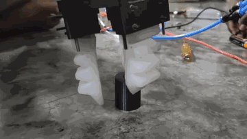
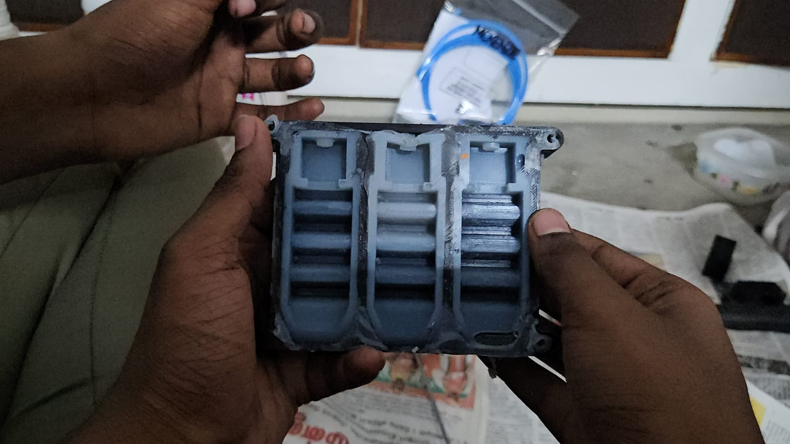
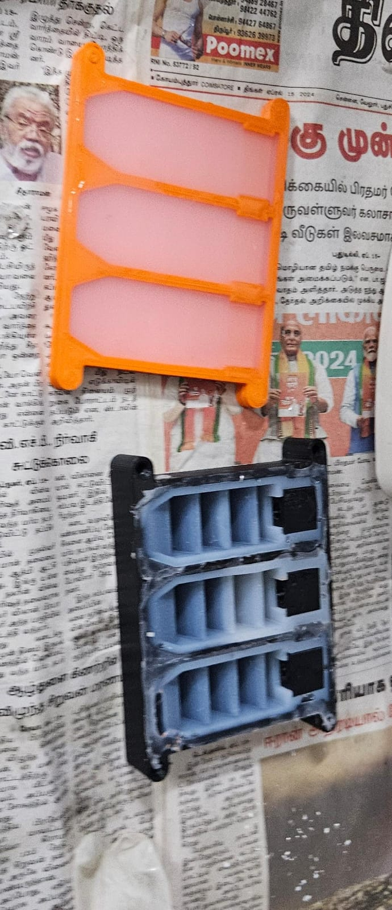
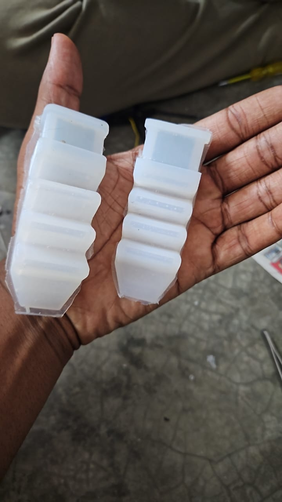
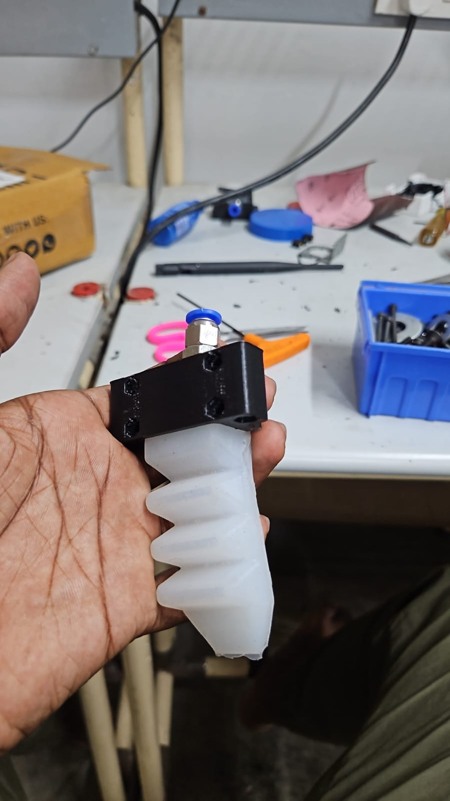
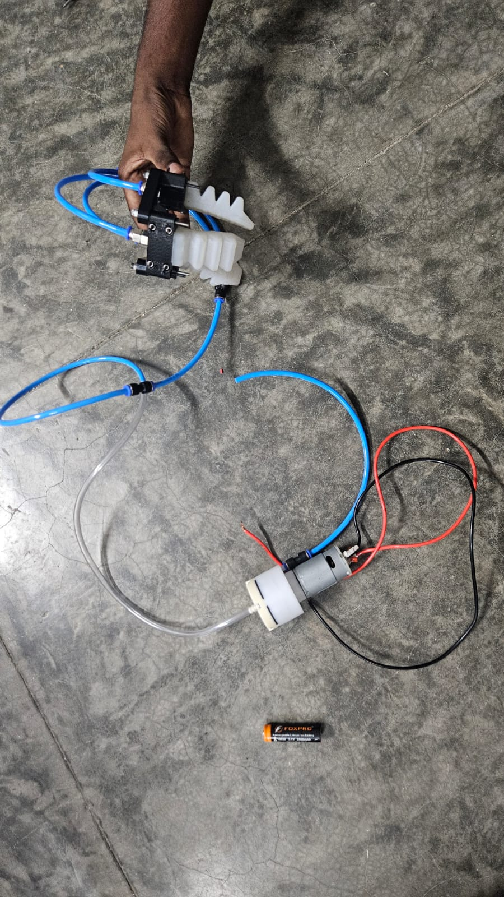
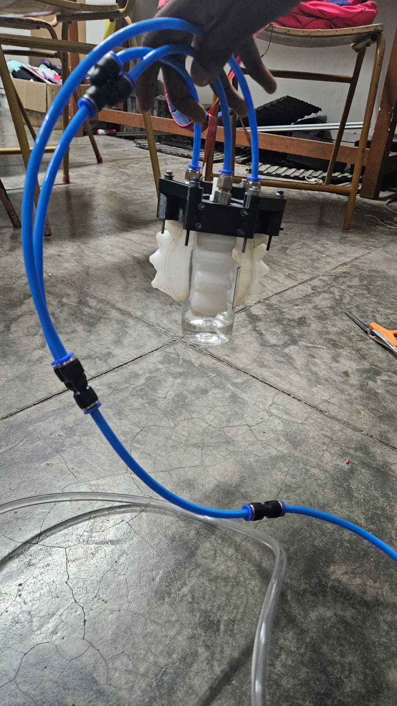
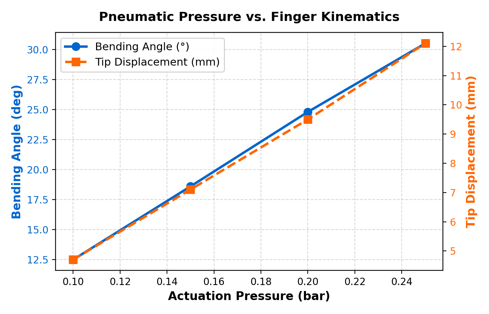
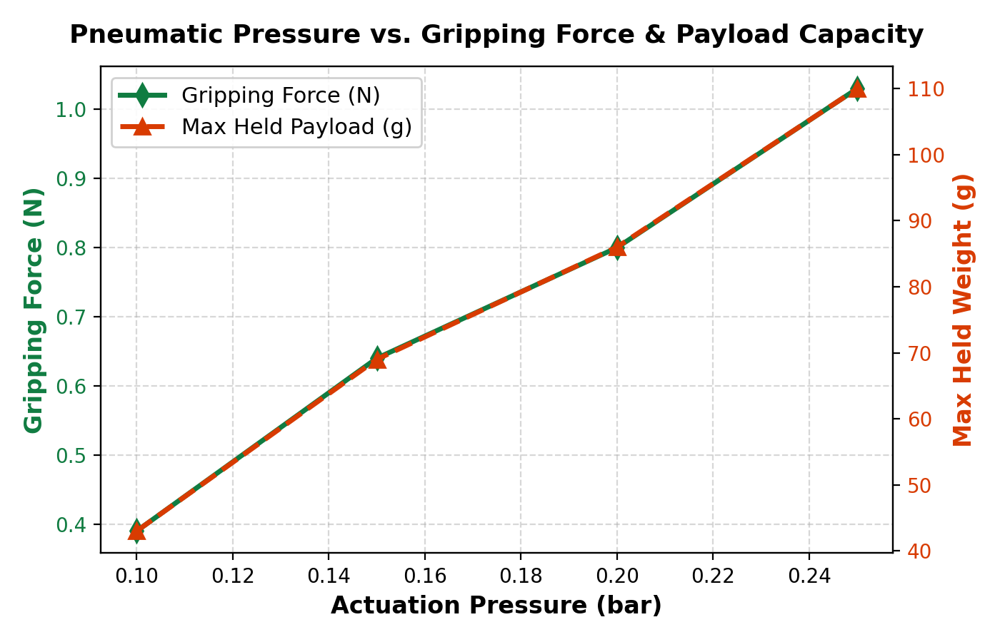
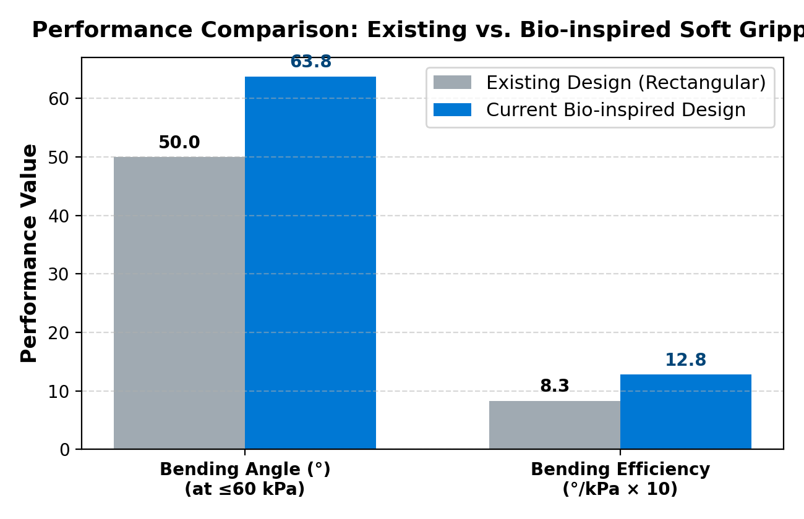

<div align="center">

# Bio-Inspired Soft 3-Claw Pneumatic Gripper
### *Adaptive, Dexterous, and Safe Object Manipulation for Fragile & Inhomogeneous Materials*

[](LICENSE)
[](paper/README.md)
[](https://www.psgtech.edu/)
[](cad/)
[](#object-handling--validation)
[](#material-properties-lsr-105)

<br/>



<p><em>Real-time pneumatic actuation and dynamic grasping of objects using 3-claw silicone finger actuators.</em></p>

</div>

---

## 📌 Overview

This repository hosts the complete open-source hardware designs, CAD models, 3D printing STL files, finite element analysis (FEA) models, and experimental characterization code for the **Soft 3-Claw Pneumatic Gripper**. 

Developed at the **Department of Robotics and Automation Engineering, PSG College of Technology**, this research addresses the limitations of conventional rigid robotic end-effectors in handling delicate, deformable, or geometrically irregular objects. Drawing bio-inspired cues from the dexterity of **octopus tentacles** and **plant tendrils**, the gripper achieves high compliance and distributed contact pressure through hyperelastic **Liquid Silicone Rubber (LSR-105)** finger modules actuated via pneumatic positive/negative pressure cycles.

### 🌟 Key Highlights

- **Bio-Inspired Architecture**: Emulates octopus tentacle flexibility to distribute contact forces evenly, avoiding stress concentrations on fragile objects.
- **Radial Symmetry**: 3 fingers arranged at $120^\circ$ radial offsets around a central mounting plate for omnidirectional grasp stability.
- **Two-Stage Hybrid Casting**: Combines 3D-printed PLA positive/negative molds with a 2-stage silicone casting process for repeatable, airtight bellows chambers.
- **High Actuation Efficiency**: Achieves **$1.28^\circ/\text{kPa}$ bending efficiency** ($63.8^\circ$ at $50\text{ kPa}$), outperforming conventional rectangular soft actuators ($0.83^\circ/\text{kPa}$).
- **Non-Destructive Manipulation**: **$>95\%$ grasping success rate** across 20 distinct object types (fresh eggs, glassware, electronic components, fluid containers).
- **Fatigue Resilience**: Demonstrates zero residual strain and fatigue-free operation over **$200+$ continuous cycles**.

---

## 📸 Prototype & Experimental Gallery

<div align="center">
<table>
  <tr>
    <td align="center"><b>3D-Printed Finger Molds</b></td>
    <td align="center"><b>Two-Stage Mold Assembly</b></td>
  </tr>
  <tr>
    <td></td>
    <td></td>
  </tr>
  <tr>
    <td align="center"><b>Demolded Silicone Actuators</b></td>
    <td align="center"><b>Assembled Single Finger Module</b></td>
  </tr>
  <tr>
    <td></td>
    <td></td>
  </tr>
  <tr>
    <td align="center"><b>Complete Pneumatic System</b></td>
    <td align="center"><b>Grasping Test (Water Bottle)</b></td>
  </tr>
  <tr>
    <td></td>
    <td></td>
  </tr>
</table>
</div>

---

## 📑 Table of Contents

- [Overview](#-overview)
- [Prototype Gallery](#-prototype--experimental-gallery)
- [System Architecture & Pneumatics](#-system-architecture--pneumatics)
- [Material Properties (LSR-105)](#-material-properties-lsr-105)
- [3D CAD Models & Fabrication](#-3d-cad-models--fabrication)
- [Kinematics & Experimental Results](#-kinematics--experimental-results)
- [Finite Element Analysis (FEA)](#-finite-element-analysis-fea)
- [Object Handling & Validation](#-object-handling--validation)
- [Repository Structure](#-repository-structure)
- [Quick Start & Simulation Scripts](#-quick-start--simulation-scripts)
- [Citation](#-citation)
- [Authors & Affiliations](#-authors--affiliations)
- [License](#-license)

---

## ⚙️ System Architecture & Pneumatics

The gripper operates via pneumatic actuation driven by a compact 12V DC mini diaphragm vacuum/air pump. Pressure is symmetrically distributed to each of the three fingers via a pneumatic distribution manifold and flexible polyurethane (PU) tubing.

```
       [ 12V DC Power / Battery ]
                    │
                    ▼
     [ Mini Diaphragm Pump (Air/Vac) ]
                    │
                    ▼
     [ PU Tubing (4mm OD / 2.5mm ID) ]
                    │
         [ 1-to-3 Push-in Manifold ]
          ┌─────────┼─────────┐
          ▼         ▼         ▼
     [ Claw 1 ] [ Claw 2 ] [ Claw 3 ]
          └─────────┴─────────┘
                    │
     Mounted to 3-Finger Base (120°)
```

- **Inflation (Positive Pressure $0.10 - 0.25\text{ bar}$)**: Chambers expand, creating asymmetric strain along the bellows geometry that induces uniform inwards bending for grasping.
- **Deflation / Neutral ($0\text{ bar}$)**: Hyperelastic elastic recovery returns fingers to baseline position.
- **Negative Pressure / Vacuum**: Induces outwards curling to expand gripper aperture for large objects.

---

## 🧪 Material Properties (LSR-105)

The soft fingers are fabricated from **LSR-105** (Liquid Silicone Rubber), an addition-cure room-temperature vulcanizing elastomer:

| Property | Value | Unit | Test Standard / Note |
| :--- | :--- | :--- | :--- |
| **Shore Hardness** | 05 A | Shore A | ASTM D2240 |
| **Density ($\rho$)** | 1100 (1.10) | $\text{kg/m}^3$ ($\text{g/cm}^3$) | DIN 53479 |
| **Viscosity** | 3000 | $\text{cps}$ | At $25^\circ\text{C}$ |
| **Tensile Strength** | $\ge 35$ | $\text{kgf/cm}^2$ (~$3.43\text{ MPa}$) | ASTM D412 |
| **Young's Modulus ($E$)** | 0.10 | $\text{MPa}$ | Linear elastic regime |
| **Poisson's Ratio ($\nu$)** | 0.495 | — | Near-incompressible |
| **Shear Modulus ($G$)** | 0.033 | $\text{MPa}$ | $G = \frac{E}{2(1+\nu)}$ |
| **Bulk Modulus ($K$)** | 150 | $\text{MPa}$ | $K = \frac{E}{3(1-2\nu)}$ |

---

## 📐 3D CAD Models & Fabrication

All parametric models and 3D printable meshes are available in the [`cad/`](cad/) directory:

| Component | File Path | Format | Description |
| :--- | :--- | :--- | :--- |
| **Bottom Mold** | [`cad/stl/base_mold_bottom.stl`](cad/stl/base_mold_bottom.stl) | STL | Lower cavity forming finger curvature and sealing rails |
| **Center Mold Core** | [`cad/stl/center_mold_chambers.stl`](cad/stl/center_mold_chambers.stl) | STL | Center core creating internal pneumatic chambers and ribs |
| **Outer Mold Top** | [`cad/stl/outer_mold_top.stl`](cad/stl/outer_mold_top.stl) | STL | Top enclosure for outer layer casting |
| **Gripper Base Plate**| [`cad/step/gripper_base_plate.step`](cad/step/gripper_base_plate.step) | STEP | Symmetric 3-finger mounting plate with air tube routing |
| **Finger Holder** | [`cad/step/finger_holder_bracket.step`](cad/step/finger_holder_bracket.step)| STEP | Rigid clamp bracket securing fingers to base |
| **Pneumatic Inlet** | [`cad/step/pneumatic_air_inlet.step`](cad/step/pneumatic_air_inlet.step) | STEP | M5 push-in adapter interface |
| **Internal Insert** | [`cad/step/finger_insert_core.step`](cad/step/finger_insert_core.step) | STEP | Finger internal alignment insert |

> 📖 **Full Instructions**: See [`cad/README.md`](cad/README.md) for slicer settings, and [`docs/FABRICATION_GUIDE.md`](docs/FABRICATION_GUIDE.md) for the complete 2-stage casting manual.

---

## 📊 Kinematics & Experimental Results

The prototype was experimentally evaluated across pressure increments from $0.10\text{ bar}$ ($10\text{ kPa}$) to $0.25\text{ bar}$ ($25\text{ kPa}$).

### Experimental Data

<div align="center">

| Actuation Pressure ($\text{bar}$) | Bending Angle ($\theta$, deg) | Tip Displacement ($\delta$, mm) | Gripping Force ($F$, N) | Max Held Payload ($m$, g) |
| :---: | :---: | :---: | :---: | :---: |
| **0.10** | $12.5^\circ$ | $4.7\text{ mm}$ | $0.39\text{ N}$ | $43\text{ g}$ |
| **0.15** | $18.6^\circ$ | $7.1\text{ mm}$ | $0.64\text{ N}$ | $69\text{ g}$ |
| **0.20** | $24.8^\circ$ | $9.5\text{ mm}$ | $0.80\text{ N}$ | $86\text{ g}$ |
| **0.25** | $30.5^\circ$ | $12.1\text{ mm}$ | $1.03\text{ N}$ | $110\text{ g}$ |

</div>

### Validation Curves

<div align="center">
<table>
  <tr>
    <td align="center"><b>Pneumatic Pressure vs. Kinematics</b></td>
    <td align="center"><b>Pressure vs. Force & Payload</b></td>
  </tr>
  <tr>
    <td></td>
    <td></td>
  </tr>
</table>

<p><b>Performance Benchmark Comparison</b></p>

</div>

---

## 🔬 Finite Element Analysis (FEA)

The silicone actuator is modeled as a near-incompressible hyperelastic material based on the **3rd-order Yeoh strain energy potential**:

$$W = C_1(I_1 - 3) + C_2(I_1 - 3)^2 + C_3(I_1 - 3)^3$$

- **Discretization**: 120,000 – 180,000 quadratic tetrahedral elements with hybrid formulation (`C3D10H`).
- **Mesh Sensitivity**: Verified with element sizes from $2.5\text{ mm}$ to $0.8\text{ mm}$ ($<1.5\%$ tip displacement variance).
- **Boundary Conditions**: Fixed constraint at proximal mounting interface; uniform internal cavity pressure ramped quasi-statically.
- **Bending Efficiency**: Attained **$1.28^\circ/\text{kPa}$** (versus $0.83^\circ/\text{kPa}$ for rectangular baseline).

> 📖 **Full Analysis**: See [`docs/FEA_AND_KINEMATICS.md`](docs/FEA_AND_KINEMATICS.md) for equations, derivation, and simulation setup.

---

## 📦 Object Handling & Validation

The gripper underwent experimental validation across **20 different test objects** categorized by geometry, fragility, and surface compliance:

- **Fragile Objects**: Fresh poultry eggs, disposable paper cups, light bulbs.
- **Compliant Objects**: Silicone balls, fruit, soft packaging.
- **Rigid Industrial Objects**: Grease boxes ($75 - 80\text{ g}$), fluid bottles ($60 - 80\text{ g}$), computer mice, PCB boards.

**Results**:
- Grasping success rate: **$>95\%$**.
- Damage to delicate surfaces: **$0\%$ (Zero cracks, punctures, or marks)**.
- Continuous actuation fatigue life: **$>200$ cycles** without hysteresis or structural degradation.

---

## 🗂 Repository Structure

```
├── README.md                      # Primary project documentation & showcase
├── LICENSE                        # MIT License
├── CITATION.cff                   # Citation file for academic referencing
├── .gitignore                     # Git ignore rules
│
├── cad/                           # Computer-Aided Design Models
│   ├── README.md                  # Slicing & printing parameters
│   ├── stl/                       # 3D printable mold mesh files
│   │   ├── base_mold_bottom.stl
│   │   ├── center_mold_chambers.stl
│   │   └── outer_mold_top.stl
│   ├── step/                      # Parametric CAD source files
│   │   ├── gripper_base_plate.step
│   │   ├── finger_holder_bracket.step
│   │   ├── pneumatic_air_inlet.step
│   │   ├── finger_insert_core.step
│   │   ├── bottom_mold.step
│   │   ├── middle_mold.step
│   │   └── top_mold_plate.step
│   └── raw/                       # Original CAD files
│
├── docs/                          # Comprehensive Technical Guides
│   ├── FABRICATION_GUIDE.md       # Step-by-step silicone casting manual
│   ├── FEA_AND_KINEMATICS.md      # Hyperelastic modeling and kinematics
│   └── BILL_OF_MATERIALS.md      # Complete BOM and hardware parts list
│
├── media/                         # High-res photos, demonstration GIF, and plots
│   ├── gripper_demo.gif           # Real-time actuation demonstration
│   ├── kinematics_plot.png        # Pressure vs Bending / Tip Displacement
│   ├── gripping_force_plot.png    # Pressure vs Gripping Force / Payload
│   ├── performance_comparison.png # Comparison bar chart
│   └── *.jpg / *.mp4              # Prototype and testing photos/videos
│
├── paper/                         # Publication Materials & PDF
│   ├── README.md                  # Publication metadata and BibTeX
│   └── A_Soft_Multi_finger_Pneumatic_Gripper_Springer_Chapter.pdf
│
└── scripts/                       # Python Analysis & Plotting Tools
    ├── requirements.txt           # Dependencies (matplotlib, numpy, scipy)
    ├── plot_experimental_curves.py# Reproduces publication validation plots
    └── yeoh_hyperelastic_model.py # Yeoh constitutive model evaluation
```

---

## 🚀 Quick Start & Simulation Scripts

### Prerequisites

```bash
# Clone the repository
git clone https://github.com/Parthiban733/soft-pneumatic-gripper.git
cd soft-pneumatic-gripper

# Install Python dependencies
pip install -r scripts/requirements.txt
```

### Reproduce Experimental Plots

```bash
python scripts/plot_experimental_curves.py
```
*Generates high-resolution publication charts in the `media/` directory.*

### Run Yeoh Constitutive Model Evaluation

```bash
python scripts/yeoh_hyperelastic_model.py
```
*Evaluates the 3rd-order Yeoh strain energy density, Cauchy stress, and analytical bending predictions.*

---

## 📜 Citation

If you use this CAD design, silicone casting methodology, FEA constitutive model, or experimental data in your academic work, please cite our chapter:

```bibtex
@incollection{sarvesh2027softgripper,
  author    = {Sarvesh, R. and Parthiban, M. and Vijitha, K. and Udhayamathi, S. and Vishwa Priya, V. and Pratheesh Kumar, S.},
  title     = {A Soft, Multi-finger Pneumatic Gripper for Versatile and Safe Object Handling},
  booktitle = {Advancements in Automation, Robotics and Sensing},
  publisher = {Springer Nature Switzerland},
  year      = {2027},
  address   = {Cham, Switzerland}
}
```

---

## 👥 Authors & Affiliations

**Department of Robotics and Automation Engineering, PSG College of Technology**, Coimbatore, 641004, Tamil Nadu, India:

- **R. Sarvesh** — `sarvesh.r.clg@gmail.com` | [ORCID: 0009-0000-4367-1953](https://orcid.org/0009-0000-4367-1953)
- **M. Parthiban** ([About Me](ABOUT_ME.md) • [Portfolio](https://drive.google.com/drive/folders/1plAiarodJJnpclTDpu9Z_DoSl9fzpq2I) • [LinkedIn](https://www.linkedin.com/in/parthiban-m-55688a286)) — `parthiban272005@gmail.com` | [ORCID: 0009-0003-9127-4938](https://orcid.org/0009-0003-9127-4938)
- **K. Vijitha** — `kvijitha942006@gmail.com` | [ORCID: 0009-0005-7389-2470](https://orcid.org/0009-0005-7389-2470)
- **S. Udhayamathi** — `udhayamathi0706@gmail.com` | [ORCID: 0009-0000-6932-1943](https://orcid.org/0009-0000-6932-1943)
- **Dr. V. Vishwa Priya** — `vvp.rae@psgtech.ac.in` | [ORCID: 0000-0003-2493-7511](https://orcid.org/0000-0003-2493-7511)
- **Dr. S. Prabhakaran** — `spk.rae@psgtech.ac.in`

---

## 📄 License

This project is licensed under the [MIT License](LICENSE) — feel free to use, modify, and distribute for academic, research, and commercial applications.
